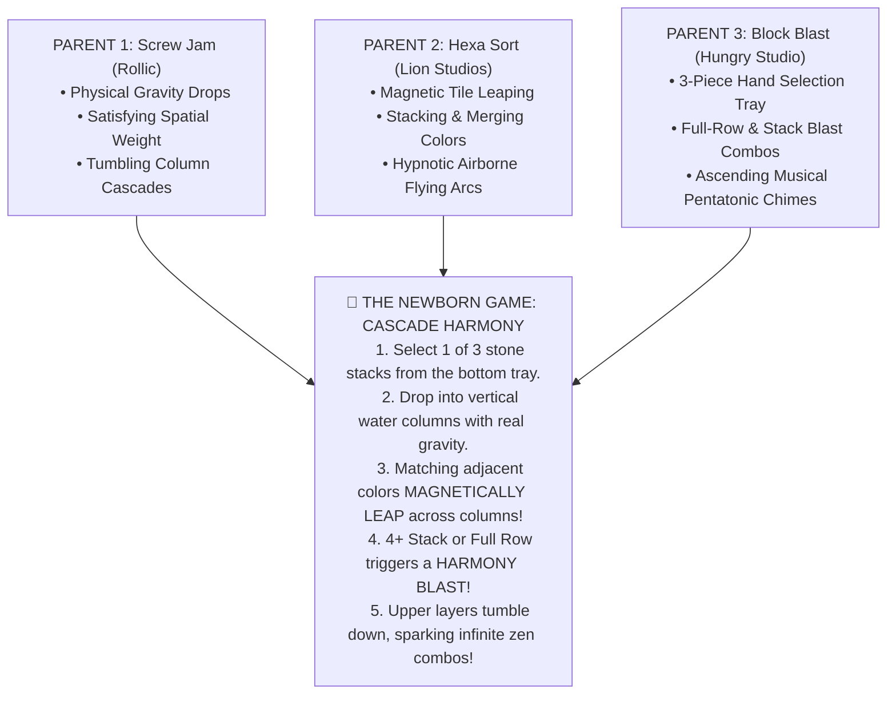

# Executive Studio Pitch Deck: CASCADE HARMONY (Pro Edition)
**Cross-Breeding the 3 Biggest Hits of 2024 into a Truly Unique 30+ Relaxing Puzzle**

---

## 1. Executive Summary: The Genetic Cross-Breeding

Instead of copying an existing Play Store title, *Cascade Harmony* takes the **3 biggest multi-million dollar breakout sensations of 2024** and breeds their core genetic mechanics into a single, never-before-seen game loop:

---

## 2. High-Addiction Pro Features Implemented

### A. The Rainbow Prism Wildcard Stone 🌈
* A rare glowing multi-colored prism stone spawns randomly in your hand tray.
* When dropped, it **matches with EVERY color**, magnetically pulling all neighboring stones together into a mega Lotus Bloom!

### B. Tactical Boosters (The Dopamine Triggers)
1. **🔨 Zen Hammer (2x):** Tap the hammer and tap any column to shatter an annoying stone that is blocking your stack.
2. **🧲 Magnet Vortex (1x):** Tap the magnet to trigger an instant board-wide magnetic pull—every scattered stone on the board takes flight to merge with its closest matching neighbor!

### C. Level Progression & 3-Star Celebrations
* Each pond level features a clear **Lotus Blossom Target** (e.g. *0 / 8 Lotus Pops*).
* A golden liquid progress bar fills in real-time.
* Beating the level opens a **🌟 LEVEL COMPLETE! 🌟** modal with lotus confetti, score summaries, and advancing to higher pond layouts.

### D. Zen Fever Mode (Double Points!)
* Hitting a 2x or 3x combo ignites **ZEN FEVER MODE**:
* The pond water ripples with bioluminescent emerald light, the combo banner pulses with fireflies, and all points double!

---

## 3. Why Adults Aged 30+ Get Hopelessly Hooked

| Psychological Need (30+ Demographics) | How Cascade Harmony Solves It |
| :--- | :--- |
| **After-Work Stress & Mental Fatigue** | **Zero Timers, Zero Failures:** No alarms, no lives lost, no rush. Pure decompression and cortisol reduction. |
| **Tactile "Order from Chaos" Craving** | Dropping a single piece triggers an automatic chain reaction where the entire messy board sorts itself. |
| **One-Thumb Accessibility** | Playable while holding tea, lying in bed, or on the metro commute. |
| **ASMR Sensory Pleasure** | Native Web Audio procedural water droplets, smooth wooden stone clicks, and soothing pentatonic melodies. |

---

## 4. Live Playable Prototype
* **Location:** [`e:\THE DARK\index.html`](file:///e:/THE%20DARK/index.html)
* **Execution:** Runs in any browser on PC and mobile phones at 60 FPS.
* **Controls:** Tap piece to select, tap column to drop, or use Hammer and Magnet boosters!
